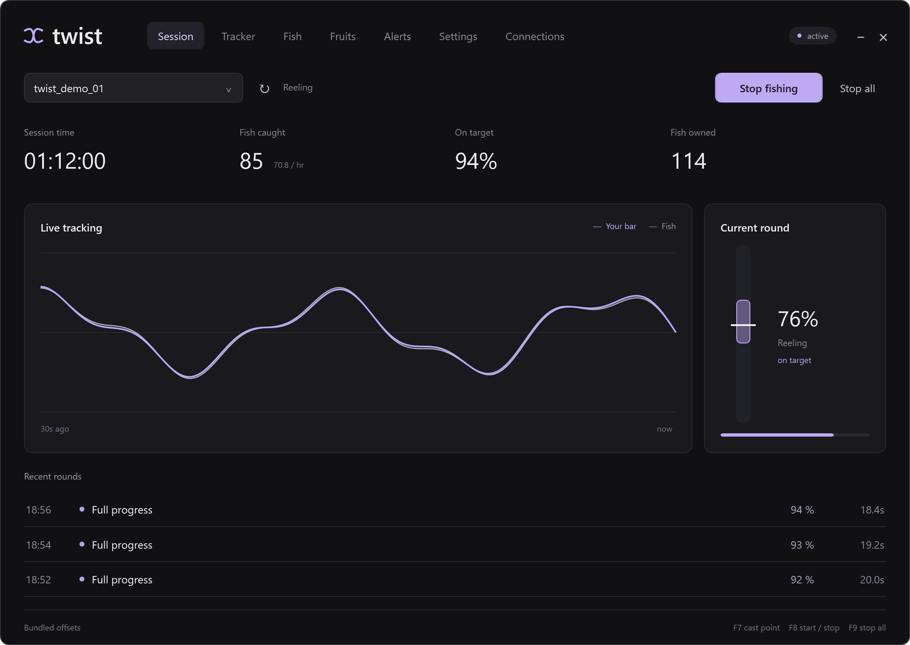

<h1 align="center">twist</h1>

A compact fishing macro for Grand Piece Online.

  
  

  <strong><a href="https://github.com/stellsor/twist/releases/latest">Download twist</a></strong>
  &nbsp;·&nbsp;
  <a href="docs/USAGE.md">Usage guide</a>
  &nbsp;·&nbsp;
  <a href="docs/examples/README.md">Screenshots</a>
  &nbsp;·&nbsp;
  <a href="CHANGELOG.md">What's new</a>

---

## Start fishing

1. Download the latest release and **extract the entire ZIP**.
2. Open **twist Launcher.exe** and choose **Local** for one PC, or **Controller + Workers** for RDP.
3. Equip your rod in GPO, set a cast point over the water, and press **Start fishing**.

In a worker, use **Select cursor point**, then **right-click** the spot in Roblox. In Local mode, point at the water and press **F7**.

Keep Roblox in the foreground in each fishing session. twist uses that session's mouse and keyboard.

## Choose your mode

| Mode | Use it for |
| --- | --- |
| **Local** | Fishing and viewing stats on the PC you are using. |
| **Controller** | Managing your accounts from the main desktop. |
| **Worker** | Running the macro inside a separate Windows/RDP session. |

For multiple accounts, run one worker per RDP session and connect them to your controller. Choose **Total · all accounts** to view combined stats or start them together. [Full setup →](docs/USAGE.md#multiple-accounts-with-rdp)

## Features

| Feature | What it does |
| --- | --- |
| **Auto fishing** | Casts, waits for a bite, and controls the fishing minigame. |
| **Bait management** | Uses Common or the best available bait, with a custom restock threshold and purchase amount. |
| **Fruit handling** | Equips and stores new devil fruits, with optional duplicate dropping. |
| **Catch tracker** | Tracks catches, runtime, fish per hour, and catch history. |
| **Live inventories** | Shows fish and stored fruits with images, quantities, and rarity filters. |
| **Discord alerts** | Reports stored fruits and fishing stats, with optional Mythical pings. |

Settings save automatically. Workers detect reopened Roblox clients; press **Start** to resume fishing.

## Screenshots

Actual UI with demo accounts and statistics.

[View all 9 screenshots →](docs/examples/README.md)

## Controls

**F7** — save cast point &nbsp;·&nbsp; **F8** — start / stop &nbsp;·&nbsp; **F9** — stop

## Updates

The launcher checks for app updates and offsets when opened. When **Download update** appears, close the controllers and workers using that folder, then accept the update. Your settings and history carry over.

[Read the usage guide](docs/USAGE.md) for bait settings, fruit storage, alerts, and UI alignment.
