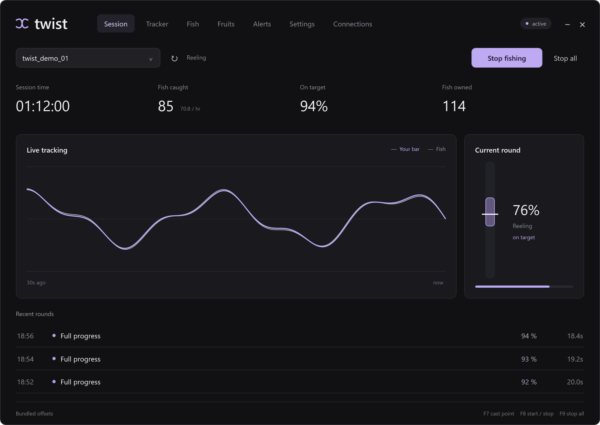

<h1 align="center">twist</h1>

A compact fishing macro for Grand Piece Online.

  
  

  <strong><a href="https://github.com/stellsor/twist/releases/latest">Download twist</a></strong>
  &nbsp;·&nbsp;
  <a href="twist/docs/USAGE.md">Usage guide</a>
  &nbsp;·&nbsp;
  <a href="twist/docs/examples/README.md">Screenshots</a>
  &nbsp;·&nbsp;
  <a href="twist/CHANGELOG.md">What's new</a>

---

## Start fishing

Requires **Windows x64** and **.NET Framework 4.8**.

1. Download **twist-0.7.31-public.zip** or a newer `twist-VERSION-public.zip` from the release’s **Assets**, then **extract the entire ZIP**.
2. Keep the **app** folder beside **twist Launcher.exe**. Open the launcher and choose **Local** for one account, or **Controller + Workers** for RDP.
3. Equip your rod in GPO and choose your bait in **Settings**.
4. Save a cast point over the water, then press **Start fishing**.

In a worker, use **Select cursor point**, then **right-click** the spot in Roblox. In Local mode, point at the water and press **F7**.

Keep Roblox in the foreground in each fishing session. twist uses that session's mouse and keyboard.

**Step-by-step setup:** [One account](twist/docs/USAGE.md#one-account-local-mode) · [Multiple accounts with RDP](twist/docs/USAGE.md#multiple-accounts-with-rdp) · [Troubleshooting](twist/docs/USAGE.md#common-problems)

## Choose your mode

| Mode | Use it for |
| --- | --- |
| **Local** | Fishing and viewing stats on the PC you are using. |
| **Controller** | Managing your accounts from the main desktop. |
| **Worker** | Running the macro inside a separate Windows/RDP session. |

For multiple accounts, run one worker per RDP session and connect them to your controller. Choose **Total · all accounts** to view combined stats or start them together. [Full setup →](twist/docs/USAGE.md#multiple-accounts-with-rdp)

## Features

| Feature | What it does |
| --- | --- |
| **Auto fishing** | Casts, waits for a bite, and controls the fishing minigame. |
| **Bait management** | Uses Common or the best available bait, with a custom restock threshold and purchase amount. |
| **Fruit handling** | Equips and stores new devil fruits, with optional duplicate dropping and bounded backpack click recovery. |
| **World** | Worker coordinates, All Seeing Eye countdowns, and saved AFK history. |
| **Spawn alerts** | Sends the exact fruit-spawn announcement and Eye pulse coordinates to Discord, with saved history in World. Requires an All Seeing Eye. |
| **Activity log** | Search saved events, see why fishing stopped, and export saved Activity to a TXT file. |
| **Catch tracker** | Tracks catches, runtime, fish per hour, and catch history. |
| **Live inventories** | Shows fish and stored fruits with images, quantities, rarity filters, and a Legendary fish owned total. |
| **Discord alerts** | Reports stored fruits and fishing stats, with optional Mythical pings. |

[Set up spawn alerts →](twist/docs/USAGE.md#world-coordinates-and-spawn-history)

## Fruit storage and duplicate dropping

Enable automatic fruit handling in the account’s Settings. With duplicate dropping enabled, Twist stores a fruit when no copy is already stored and drops the carried duplicate when a stored copy is detected. Twist checks the exact equipped fruit and stored ownership before sending the drop input.

If a backpack equip attempt fails, Twist records the failure, reopens the backpack and resolves the same item again. The retry temporarily bypasses saved UI alignment offsets. After two failed attempts, fishing stops with an explanation. The recovery applies to both storing fruits and dropping duplicates.

The recovery has passed simulated checks. Confirmation on the affected user’s setup is still needed.

## Send an Activity log

If fruit handling fails or clicks the wrong place, reproduce it on the latest version, then

1. Open **Activity** using the button at the bottom of Twist or **Settings → Activity**.
2. Click **Export TXT**.
3. Choose a location and save the `.txt` file.
4. Attach that file to [the backpack issue](https://github.com/stellsor/twist/issues/1), or your own issue. Include what happened and whether duplicate dropping was enabled.

The export includes all saved accounts and events, even when the Activity view is filtered. Account names and event details are included. Webhook URLs and pairing codes use the existing redaction rules. You can review the file before sharing it.

Settings save automatically. Workers detect reopened Roblox clients; press **Start** to resume fishing.

## Screenshots

Actual UI with demo accounts and statistics. Screenshots are from 0.7.20; newer versions have a few differences.

[View all 9 screenshots →](twist/docs/examples/README.md)

## Controls

**F7** — save cast point &nbsp;·&nbsp; **F8** — start / stop &nbsp;·&nbsp; **F9** — stop

## Updates

1. Close the controllers and workers using the installation folder.
2. Reopen **twist Launcher.exe** and accept **Download update** when offered.
3. Open your usual Local, Controller or Worker mode after installation. Press **Start fishing** to resume.

The launcher checks GitHub Releases for app updates and verifies the downloaded package before installation. Auto-update compatibility with 0.7.31 was checked using the original 0.7.29 launcher.

If no update is offered or installation fails, download the latest `twist-VERSION-public.zip`, extract it completely into a new folder and open its launcher. Settings and history are stored separately under your Windows user account.

[Read the usage guide](twist/docs/USAGE.md) for bait settings, fruit storage, alerts, and UI alignment.

## Source and building

The recovered C# source is available under **GPL-3.0**. See [build instructions](twist/docs/BUILD.md), [the license](LICENSE), and [asset attribution](twist/docs/ASSETS.md). Some recovered internal names remain generated.

All project code, assets, documentation and build tools are in [`twist/`](twist/). Build from the repository root with `node twist/scripts/build.mjs`.
