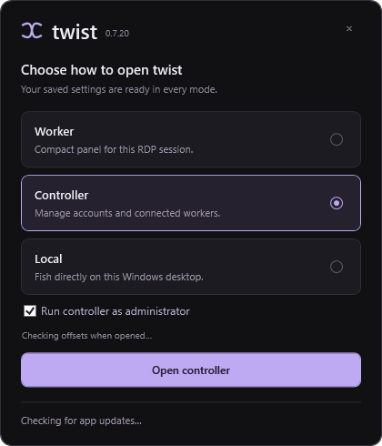
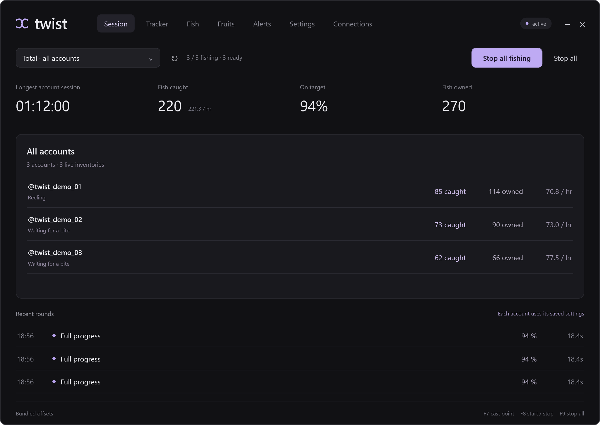
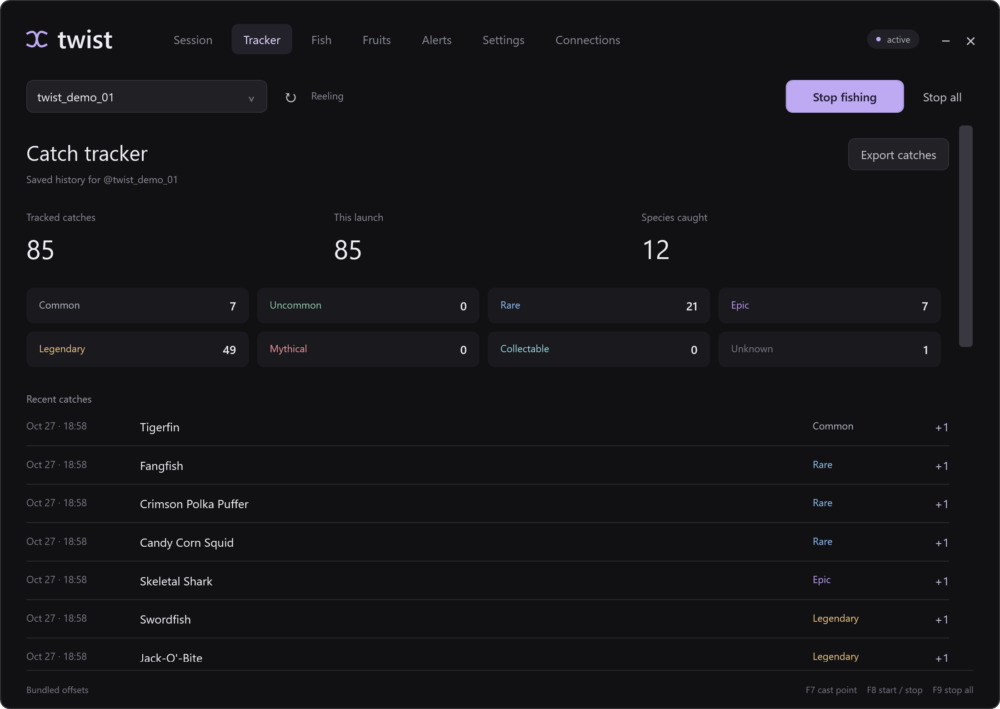
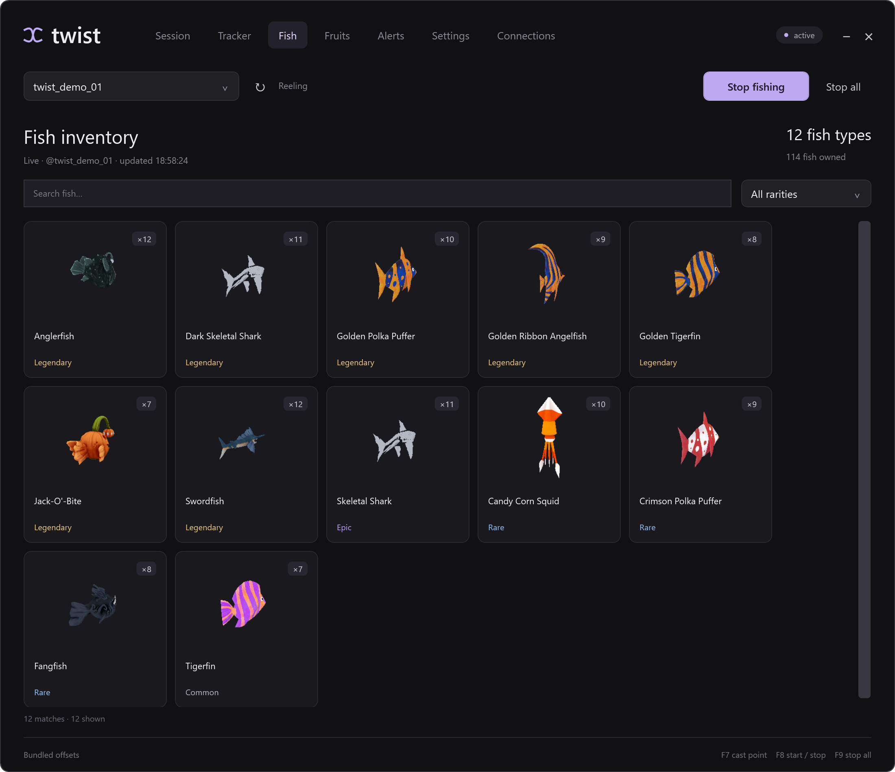
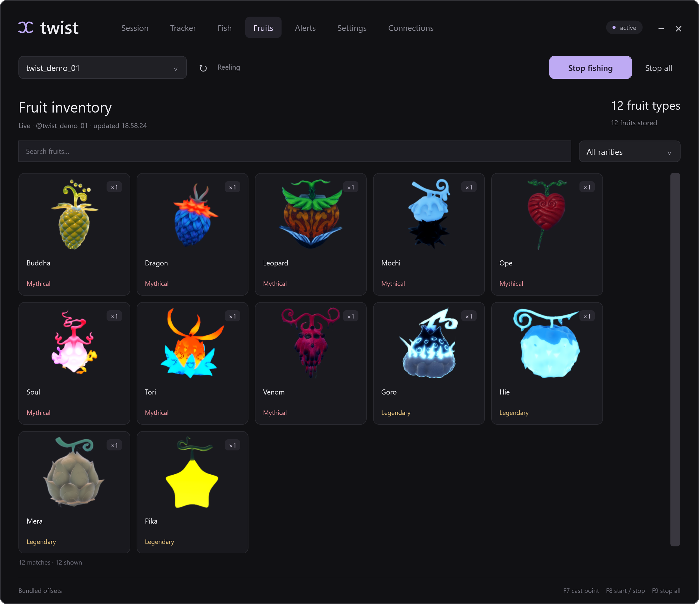
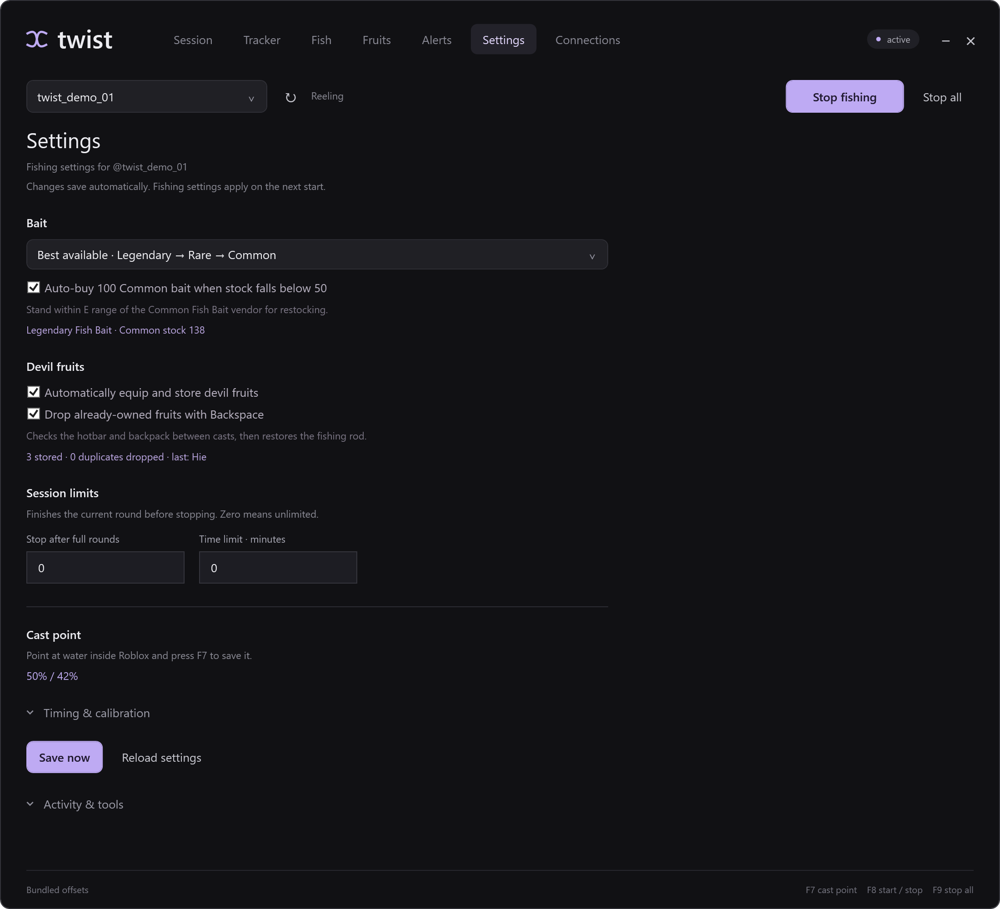
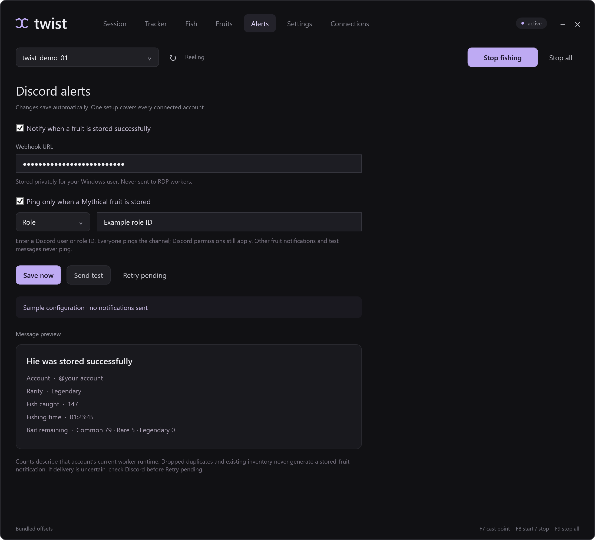
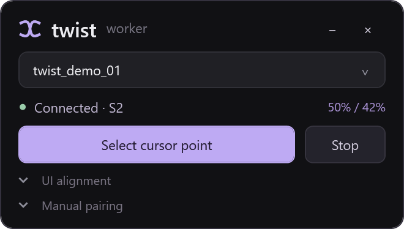

# Screenshots

[Download](https://github.com/stellsor/twist/releases/latest) · [Setup](../USAGE.md) · [Home](../../README.md)

These are from twist 0.7.20, using demo accounts and sample stats. Some details have changed in newer versions.

Launcher

Choose Local, Controller or Worker.

Session

Fishing status and the live reel tracker.

Multiple accounts

Combined stats and controls for connected accounts.

Catch tracker

Catch history and exports.

Fish inventory

Fish quantities, images and rarity filters.

Fruit inventory

Stored fruits with their icons and rarities.

Settings

Bait, restocking, fruit storage and session limits.

Discord alerts

Stored-fruit messages and Mythical ping options.

Worker

Connection status and cursor-point selection.

